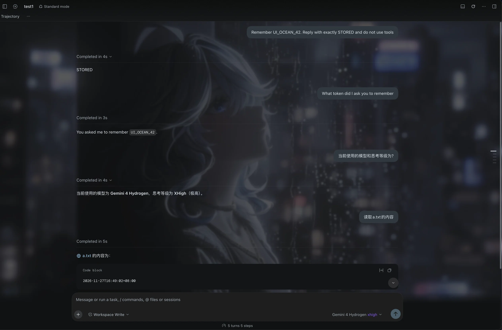

# Antigravity native ACP

English | [中文](README.zh.md)

A DSH bundle that exposes existing Antigravity CLI logins through the native model selector, Workspace, Session list, and Chat. It is an append-only ACP client, not a DSH-history replay adapter or a subagent bridge.

Published as [`dsh-antigravity-native`](https://www.npmjs.com/package/dsh-antigravity-native) on npm.



## Install from npm

Requires DSH `0.2.2-rc.5`, Node.js `>=22.19`, and an installed, already authenticated Antigravity CLI (`agy`).

```sh
# DSH Web
dsh plugin --profile web add dsh-antigravity-native

# DSH Desktop
dsh plugin --profile desktop add dsh-antigravity-native
```

You can also install `dsh-antigravity-native` through DSH's plugin manager. Enable the bundle, then create a new DSH Session and choose an **Antigravity ACP** model.

## Use

1. Sign in with the official `agy` outside DSH if it is not already signed in.
2. Install and enable this bundle.
3. Start a new DSH Session in any Workspace and select an **Antigravity ACP** model and thinking level.
4. Send messages through the ordinary DSH composer and read responses in native Chat.

The first prompt creates an agy Session in the DSH Session's current working directory. Later prompts continue the same agy Session. Restarting DSH or the agy process restores it through the persisted binding.

## Model and Session boundaries

- Model and thinking choices come from agy `configOptions`; the plugin does not hardcode a model catalog.
- Antigravity Sessions can switch among agy-advertised models but cannot switch to a DSH-native model.
- DSH-native Sessions cannot switch to Antigravity.
- An illegal cross-family selection is replaced by the latest legal selection and produces a native notice. `agent/pre-step` rejects any remaining cross-family request.
- The bound working directory cannot change. Use a new DSH Session for another directory.
- Existing DSH Sessions with prior messages cannot adopt Antigravity.

## History and tools

DSH stores the messages needed for native Chat. Antigravity independently owns the model context and tool history. Only new user messages are forwarded; prior DSH history, system prompts, and DSH tool declarations are not sent to agy. ACP text and reasoning blocks become ordinary DSH stream chunks. ACP tool notifications are not re-executed or duplicated as DSH tool calls. Permission requests use DSH's approval service and allow only one matching action.

Duplicate retries, history edits, forks, regeneration, and DSH compaction are rejected instead of replaying an uncertain task. Title generation uses an independent agy Utility Session.

## Configuration

| Field | Default | Meaning |
| --- | --- | --- |
| `binaryPath` | `agy` | Existing Antigravity CLI executable |
| `discoveryWorkspace` | — | Optional workspace for model discovery and utility requests; when unset, the DSH process working directory is used. Ordinary agy Sessions always use their own DSH Session workspace |
| `sandbox` | `true` | Pass `--sandbox` to `agy acp` |
| `requestTimeoutMs` | `30000` | ACP setup and model configuration deadline |
| `stopGraceMs` | `5000` | EOF grace before managed process termination |
| `contextWindow` | `110000` | Conservative route metadata used by DSH |
| `maxPromptBytes` | `180000` | Maximum serialized utility prompt size |

## Model Experience

The plugin adds no text to DSH-native model routes. For an Antigravity-bound Session, DSH sends only newly appended human messages to the corresponding agy Session. Antigravity owns its system prompt, history, tools, token accounting, and KV cache. DSH retains the displayed assistant text and reasoning. Editing or compacting one history cannot be represented safely in this version.

## Known limitations

- Existing agy Sessions are not imported.
- Editing, forking, regeneration, and DSH compaction are rejected for bound Sessions.
- Rich ACP tool cards, diffs, plans, and artifacts are not rendered; native running status and assistant content remain available.
- Text prompts only; attachments are not implemented.
- Model-family filtering in the picker is supplemented by automatic selection restoration and execution-time rejection rather than a Core selection hook.
- This integration has no Google or DeepSeek endorsement. Personal-subscription use remains subject to Google's terms and product-specific clarifications.

## Verification

```sh
npm install --ignore-scripts
npm run check
node scripts/probe-real.mjs /Users/river/code/agy-acp-test
```

The real probe consumes Antigravity quota and requires an already authenticated CLI.

## Friendly links

- [V2EX](https://v2ex.com/)
- [Linux.do](https://linux.do/)
- [NodeSeek](https://www.nodeseek.com/)
